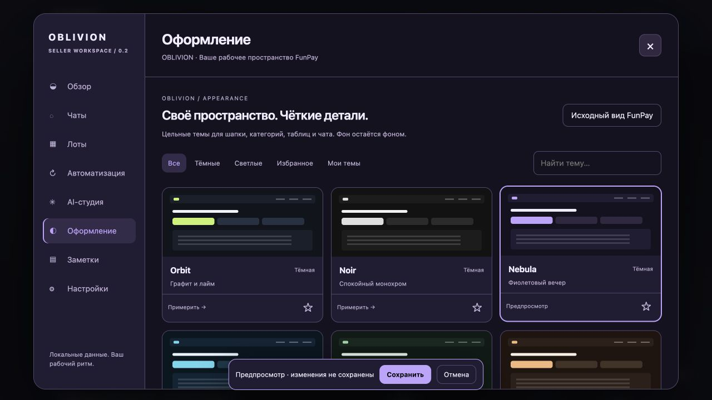
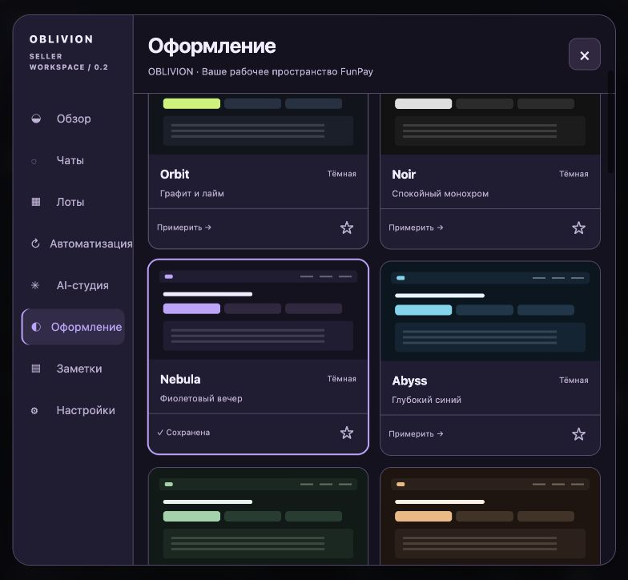
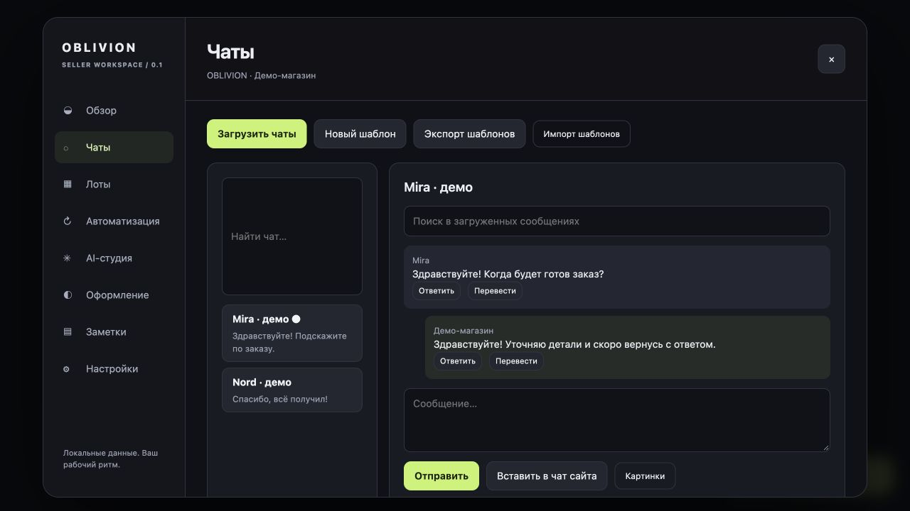

<p align="center"></p>
<h1 align="center">OBLIVION</h1>
<p align="center">Seller workspace for Firefox · FunPay · Own your workflow</p>

**Oblivion 0.2.0 — самостоятельная экспериментальная реализация для Firefox 142+.** Собственный интерфейс, клиентский код и аватарка. Код и графика Foxen в этот репозиторий не включены; полное совпадение его функций не заявляется. Это начало нашего проекта, а не переименованный прежний Safari-порт.



## Установить тестовую версию

1. Скачайте `oblivion-0.2.0.zip` из [GitHub Releases](https://github.com/44oblivion/oblivion/releases) и распакуйте архив в отдельную папку.
2. В Firefox откройте `about:debugging#/runtime/this-firefox`.
3. Нажмите «Загрузить временное дополнение» и выберите `manifest.json` из распакованной папки.
4. Откройте FunPay, авторизуйтесь и перезагрузите страницу. Кнопка **OBLIVION** появится справа внизу; горячая клавиша — **Alt+Shift+O**. Есть также кнопка на панели Firefox.

Это **неподписанная тестовая сборка**. Она устанавливается временно, до перезапуска Firefox. Обычная постоянная установка требует подписи Mozilla, даже если файл распространяется на GitHub. Подпись и публикация на addons.mozilla.org пока не выполнены. Не отключайте проверку подписей Firefox.

## Темы 0.2

Откройте **Oblivion → Оформление** (или **Темы** в меню расширения). Orbit, Noir, Nebula, Abyss, Forest, Ember, Sakura, Porcelain, Linen и Arctic используют собственные палитры и стили. Нажатие на карточку включает предпросмотр; **Сохранить** применяет выбор, **Отмена** возвращает сохранённый вид. Кнопка **Посмотреть страницу** оставляет компактную панель сохранения поверх FunPay.

Шапка, категории, формы, список предложений и чат используют общие цвета. Числа и вторичный текст сохраняют контраст; цвет текста на акцентных кнопках подбирается автоматически. «Чистая компоновка» скрывает большой круглый баннер сайта. Фоновые эффекты создаются локальным CSS, без постоянной анимации. Свои изображения затемняются, рабочие поверхности остаются непрозрачными. Режим «Исходный вид FunPay» отключает окраску, фон и свой CSS.

Для обновления временного дополнения замените файлы **в прежней распакованной папке** содержимым нового ZIP и нажмите **Перезагрузить** у Oblivion в `about:debugging`, затем обновите FunPay. Не удаляйте дополнение: удаление может стереть его локальные настройки. Для первого теста выберите готовую тему — она сбросит старый пользовательский CSS.



## Что реализовано

| Раздел          | Возможности                                                                                                                                                                                                                                         |
| --------------- | --------------------------------------------------------------------------------------------------------------------------------------------------------------------------------------------------------------------------------------------------- |
| Обзор           | Сбор истории продаж, покупок и финансов, поиск, CSV, выручка и средний чек в RUB, график распознанных дат, цели                                                                                                                                     |
| Чаты            | Список и поиск, чтение переписки, цитата, перевод по запросу, шаблоны и переменные, вложения до 10 изображений, счётчик символов                                                                                                                    |
| Лоты            | Поиск лотов текущей страницы, закрепление, собственные заметки, редактирование доступных полей, клонирование своих лотов, массовая цена, JSON-экспорт/импорт изменений, медиана цен страницы                                                        |
| Автоматизация   | Поднятие категорий, автоответы по ключевым словам, склады автовыдачи, резервирование до отправки, ручная проверка неопределённых отправок, расписание состояния лотов, журнал, общая пауза                                                          |
| AI              | Ответ покупателю/отзыву, перевод, описание лота, редактирование текста, аудит введённых описаний, изображения через OpenAI; OpenAI / OpenRouter / Gemini напрямую                                                                                   |
| Оформление      | 10 своих тем, галерея с поиском и избранным, предпросмотр/отмена, до 12 личных пресетов, контрастный акцент, светлый/тёмный/системный режим, чистая компоновка, фон и затемнение, скругления, шрифты, плотность, CSS, импорт/экспорт; звук отдельно |
| Заметки         | Личные заметки о пользователях, чёрный список автоответов, калькулятор с ручными курсами                                                                                                                                                            |
| Страницы FunPay | Личная заметка и локальная история покупателя в профиле, ручной таймер заказа, PNG-карточка текста отзыва                                                                                                                                           |
| Интеграции      | Telegram/Discord-уведомления, Telegram-команды `/stats`, `/pause`, `/help`; дополнительные доступы запрашиваются отдельно                                                                                                                           |
| Данные          | Локальные настройки, IndexedDB для истории, резервная копия без секретов и склада; импорт сохраняет локальный склад и выключает автоматизацию                                                                                                       |



**Статус проверки:** модульные тесты и DOM-тесты выполняются командой `npm test`; `web-ext lint` и сборка ZIP — командой `npm run verify`. Проверка настоящего Firefox в чистом профиле запускается отдельным шагом GitHub Actions. Актуальный результат смотрите в [Actions](https://github.com/44oblivion/oblivion/actions). Демо и тесты не подтверждают работу торговых операций в авторизованном FunPay. Подробности: [границы версии и проверки](docs/STATUS.md).

## Важные условия работы

- По умолчанию автоматизация и внешние интеграции выключены, оформление FunPay сохраняется оригинальным.
- Для AI нужен ваш API-ключ. Для Telegram/Discord — ваши токен/чат или webhook. Расширение не использует серверы Foxen или собственный промежуточный сервер.
- Для внешних функций включите нужный сервис, сохраните настройки, разрешите его домен и передачу соответствующих данных. После отзыва разрешений внешние запросы блокируются.
- Первая фоновая проверка фиксирует существующие сообщения/заказы и не обрабатывает их задним числом. Новые правила и склады получают новую стартовую точку. Фоновые проверки выполняются примерно раз в минуту при работающем Firefox. Автоматизация привязана к аккаунту, из которого вы сохранили её настройки; при несовпадении сессии операции блокируются.
- Пауза останавливает новые операции; уже отправленный HTTP-запрос отменить задним числом невозможно. Неопределённую выдачу расширение не повторяет автоматически.
- Клонирование, импорт, массовое редактирование и расписание используют формы сайта FunPay. Сначала проверьте на одном собственном тестовом лоте. Разметка и правила сайта могут меняться.
- Настройки и API-ключи находятся в хранилище браузера; отдельного шифрования ключей нет. Склад исключён из обычного backup, локальные данные не синхронизируются между устройствами.
- [Конфиденциальность](docs/PRIVACY.md) · [Состояние и ограничения](docs/STATUS.md) · [Аватарка и генерация](brand/GENERATION.md).

## Разработка

Нужны Node.js 24+ и npm. Runtime не содержит сторонних JS-библиотек, `eval`, удалённых скриптов и телеметрии. `web-ext`, `jsdom` и `prettier` используются только для разработки.

```sh
npm ci
npm run verify
npm start
```

Запуск своего Firefox:

```sh
npm start -- --firefox /path/to/firefox
```

Реальная проверка фоновой страницы, IndexedDB и загрузки content script в одноразовом Firefox:

```sh
OBLIVION_FIREFOX=/path/to/firefox node scripts/firefox-smoke.cjs
```

Скрипт создаёт отдельную временную копию расширения и тестовый профиль. Localhost-разрешения и тестовые файлы **не попадают в релиз**. Ваш обычный профиль не используется.

Демо на вымышленных данных:

```sh
python3 -m http.server 8765 --bind 127.0.0.1
# http://127.0.0.1:8765/preview/
```

Структура: `extension/background/` — адаптер FunPay, состояние, автоматизация и внешние запросы; `extension/content/` — интерфейс и инструменты страниц; `extension/shared/` — чистые функции; `tests/` — проверки; `brand/` — свои изображения; `preview/` — отдельное демо. Подробности архитектуры — в [docs/ARCHITECTURE.md](docs/ARCHITECTURE.md).

Публичный исходный код: MIT. Oblivion — неофициальный проект, не связанный с FunPay или Mozilla. Перечень возможностей выше описывает реализацию этой версии, а не гарантию полного соответствия другому расширению.
